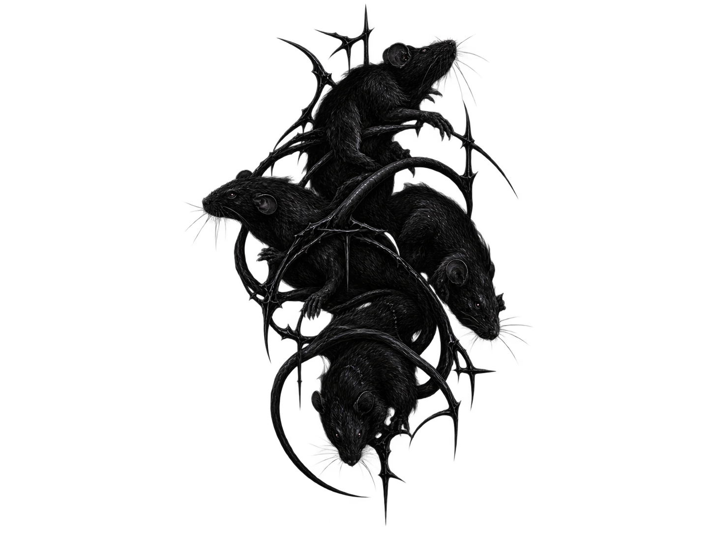

<div align="center">
  
  
  <h1>TryDecode</h1>
  
  <p><b>Automated configuration extraction and C2 traffic decryption for modern RAT families.</b></p>

  <!-- Badges -->
  <a href="https://github.com/7r13x3/TryDecode/blob/main/LICENSE"></a>
  <a href="https://www.python.org/"></a>
  
  
</div>

<br>

**TryDecode** is a modular malware analysis framework designed to automate the triage, static configuration extraction, and network traffic decryption of modern Remote Access Trojans (RATs). Built for speed, it processes packed samples and outputs clean, standardized JSON reports.

## 🚀 Features
- **🔍 YARA Triage:** Automatically identifies the malware family before analysis.
- **⚙️ Static Extraction:** Uses `dnlib` for .NET assemblies and Regex for legacy binaries.
- **📦 Automatic Unpacking:** Detects UPX-packed samples and unpacks them before analysis.
- **💻 Professional CLI:** Interactive command-line interface for scanning, extracting, and unpacking.
- **📄 JSON Reporting:** Saves extracted configs in a clean JSON format in the `reports/` folder.

## 🦠 Supported Families

| Family | Status | Extraction Method |
| :--- | :---: | :--- |
| **XWorm** | ✅ | AES-ECB |
| **AsyncRAT / DcRAT / VenomRAT** | ✅ | AES-256-CBC |
| **QuasarRAT** | ✅ | AES-256-CBC |
| **RedLine Stealer** | ✅ | Base64 JSON |
| **njRAT** | ✅ | Regex / Raw Bytes |
| **DarkComet** | ✅ | Regex / FWB Delimiter |
| **Remcos** | ✅ | RC4 Block / Regex |

## ⚙️ Setup Instructions

1. Install the required Python libraries:
   ```bash
   pip install -r requirements.txt
